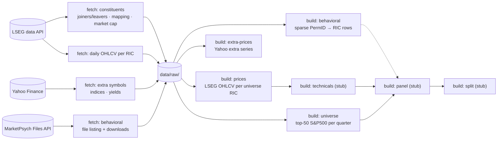

# Data

## Sample

- criteria
  - avoid selection bias
  - avoid survivorship bias
- frequency
  - daily
- period
  - 1994-2026 (universe build starts 1994, when LSEG joiner/leaver records begin)
- index
  - all S&P500 companies since 1994
- method
  - rolling top 50 companies in S&P500
  - redefine list in each period
  - exclude RICs with no price content (`universe.exclude_rics`); next-ranked company fills the slot
  - rank companies, not RICs: one RIC per LSEG PermID (share classes like GOOG/GOOGL share one company market cap); keep the RIC with the most S&P membership quarters, then alphabetical; RICs without a PermID are dropped
- alignment
  - forward-fill fundamentals from their LSEG report date with per-group staleness counter
  - time-decay for behavioral features

## Flow

Steps are existence-cached and run in manifest order; `factor-weaver data --list` shows status, `--refresh` refetches raw data (see `docs/architecture.md`).

## Variables

- for each stock (model features and calculations: `docs/features.md`)
  - price
    - daily OHLCV
  - technical (stub; computed from prices)
    - momentum, volatility, size, short-term reversal, share turnover
  - fundamental (raw fetch implemented; LSEG)
    - net share issuance, book-to-market, operating profitability, asset growth, sales-to-price
  - behavioral (LSEG MarketPsych)
    - attention — `buzz` (media coverage volume, news + social blended) → media attention
    - sentiment — `sentiment` (net polarity) → news sentiment
- extra assets
  - risk-free - `^IRX` (T-bill annualized yield, not a price)
  - S&P500 stock index - `^GSPC`
- market-wide indicators (engine/benchmark inputs, not model features)
  - VIX - `^VIX`

## Sources

- equity universe
  - LSEG data API — S&P500 constituent list, joiner/leaver history, RIC mapping; market cap via `TR.CompanyMarketCap` (fallback `TR.F.MktCap`) for top-50 selection
  - `build/universe.py` also writes `data/interim/assets.parquet`, the distinct RIC → ticker/name/permid registry used by the price steps
- price
  - LSEG data API — daily OHLCV, primary source; RTS-adjusted (splits, spin-offs) with cash dividends folded in from `TR.TotalReturn`; per-RIC cache in `data/raw/lseg/prices/`
  - PermID-resolved, universe share line: each company's US consolidated RIC (LSEG symbology) when it is the universe line (KO.N → KO), else the universe RIC; the other is the fallback (renames: PSKY.OQ → SKYD.K); a series must cover the membership window; rows labelled with the universe RIC
  - <https://finance.yahoo.com/> via `yfinance` — only the configured `extra_symbols` (`^GSPC`, `^VIX`, `^IRX`), never universe stocks; `extra-prices` build step writes them to `data/interim/extra_prices.parquet`; per-symbol cache in `data/raw/yahoo/prices/`
- fundamental
  - LSEG data API — quarterly `TR.F.*` raw cache in `data/raw/lseg/fundamentals/` (one parquet per RIC, USD, statement-level source and original announcement dates); `build/panel.py` integration not implemented
- technical
  - computed from prices (`docs/features.md`); `build/technicals.py` is a stub
- behavioral
  - using LSEG MarketPsych Analytics

## Issues

### Universe

- **Joiner/leaver history starts with a baseline snapshot in 1994**: phantom "Joiner"
  events for companies already in the index pre-1994. Top-50 universe should be unaffected
- **No market cap for some retired RICs**: a few delisted RICs (`^`-suffixed)
  return nothing for `TR.CompanyMarketCap` or `TR.F.MktCap`. Dropped from top-50 ranking in
  their active quarters; only names near the 1999-2001 boundary are affected.
- **Membership ~20 names short pre-2000**: the joiner/leaver file has ~20 more Leaver than
  real Joiner events before 2000, so reconstructed membership counts 477-505 vs. ~500
  (1994: 478). Top-50 universe should be unaffected.

### Prices

- **Retired RICs with no price content**: ENE.N^A02 has no LSEG content and is
  excluded (`universe.exclude_rics`), next-ranked company backfills its 2 quarters (2000Q3/Q4).
  FSR.N^B01 (no content) shares USB.N's PermID, so PermID dedup keeps USB.N instead. There is
  no other stock-price source: a RIC LSEG cannot serve over its membership window has no
  cache, and `build prices` lists it as missing
- **Dividends are derived**: LSEG RTS adjusts splits and spin-offs but not cash dividends
  (closes equal Yahoo's unadjusted Close). `fetch_history` back-adjusts OHLC by each day's
  price-return / total-return factor from `TR.TotalReturn`, the basis of Yahoo's auto_adjust;
  a RIC without `TR.TotalReturn` stays dividend-unadjusted with a warning
- **Consolidated volume needs consolidated RICs**: exchange RICs (`.N`, `.OQ`) count their own
  venue only, 25–35% of consolidated volume since 2010; the PermID query returns consolidated
  RICs (AAPL.O, JNJ). NASDAQ volume before 2004 is not halved for double counting (Gao and
  Ritter 2010 adjustment; [medhat-2022-short-term-momentum] finds no effect). Companies
  whose PermID resolves to another share line (class, preferred, bond, when-issued) are priced
  from their exchange RIC and keep exchange volume (BRKb, MER, RAI, S and TWX^F18 after 2007)
- **Existence-based caches**: reference files and per-RIC/per-symbol price caches are
  skipped when present; use `factor-weaver data fetch --refresh` (optionally per step,
  e.g. `data fetch lseg-constituents --refresh`) instead of deleting files

### Behavioral

- **Sparse rows are intentional**: companies only have rows on non-zero-buzz days, so
  `behavioral.parquet` has no row for a day without media coverage; 1994-1997 is empty by
  construction (history starts 1998-01)
