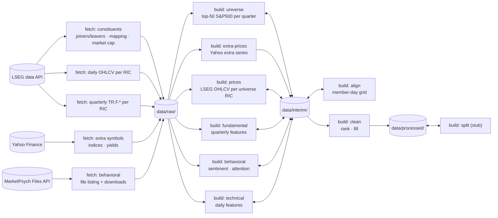

# Data

## Sample

- criteria
  - avoid selection bias
  - avoid survivorship bias
- frequency
  - daily
- period
  - 1998-2026 (first universe snapshot 1997-12-31; behavioral data starts 1998)
- index
  - all S&P500 companies (joiner/leaver history since 1994)
- method
  - rolling top 50 companies in S&P500
  - redefine list in each period
  - membership on the first holding day (first `^SP500TR` trading day after $q$): S&P announces changes days ahead, so a removal effective that day (merger closing on $q$: BAC^I98, GTE, FBF, G, BLS) is never held and the next-ranked company fills the slot
  - exclude RICs with no price content (`universe.exclude_rics`); next-ranked company fills the slot
  - rank companies, not RICs: one RIC per LSEG PermID (share classes like GOOG/GOOGL share one company market cap); keep the RIC with the most S&P membership quarters, then alphabetical; RICs without a PermID are dropped
- alignment
  - fundamentals: one row per stock-quarter at `max(source_date, original_announcement_date)`, else 60 days after period end capped before the next period; TTM flows, latest-quarter stocks, as-reported (no look-ahead)
  - technical: daily rows from adjusted prices, market cap, and quarterly shares
  - behavioral: daily calendar rows; 7-day sentiment and abnormal buzz from MarketPsych day $d$ (24 h to 15:30 ET), usable at the close of $d$
  - panel (`align` → `data/interim/panel.parquet`)
    - calendar: `^SP500TR` dates = exchange trading days (index published only when the exchange is open), applied in `build prices`: drops 6 off-calendar LSEG rows (AMGN, CELG 2003 weekends; 1994 holidays), so technicals, the panel and model look-backs share one calendar
    - rows: every member of the quarter-end $q$ snapshot on every trading day after $q$ up to the next quarter-end; NaN kept (401 mid-quarter delisting-tail days have no price)
    - `close`, `ret` = $P_t / P_{t-1} - 1$ over the previous trading day (from `prices.parquet`)
    - market columns, same for every member on a date, not features: `rf` = `^IRX`$_{t-1}$ / 100 / 252 (cash return over $(t-1, t]$; yield carried over bond-market holidays), `mkt_ret` = `^SP500TR` daily return, `vix` = `^VIX` close of $d$
    - technical, behavioral: value of day $d$
    - fundamentals: from the trading day after the availability date (after-close filings), NaN after 365 days (several missed filings)
    - `fund_date`: days since the availability date of the report in force
  - normalization (`clean` → `data/processed/panel.parquet`): features ranked per date to [-1, 1] over tradable members, NaN → 0 (`docs/features.md`); delisting tails (no `close`) masked: unranked, features 0; `close`/`ret` untouched

## Flow

Bidirectional arrows mark builds that both read and write the same store. Fetch steps are existence-cached (whole outputs or per-item caches); build steps rerun on each invocation. Selected steps pull missing producers, then run in manifest order; `factor-weaver data --list` shows status, `--refresh` refetches raw data (see `docs/architecture.md`).

## Variables

- for each stock (model features and calculations: `docs/features.md`)
  - price
    - daily OHLCV
  - technical (implemented; `build/technical.py`, from prices)
    - momentum, volatility, size, short-term reversal, share turnover
  - fundamental (implemented; `build/fundamental.py`, LSEG)
    - net share issuance, book-to-market, operating profitability, asset growth, sales-to-price
  - behavioral (implemented; `build/behavioral.py`, LSEG MarketPsych)
    - attention — `buzz` (media coverage volume, news + social blended) → media attention
    - sentiment — `sentiment` (net polarity) → news sentiment
- extra assets
  - risk-free - `^IRX` (T-bill annualized yield, not a price)
  - S&P500 total-return index - `^SP500TR` (dividends reinvested, like the stock prices)
- market-wide indicators (engine/benchmark inputs, not model features)
  - VIX - `^VIX`; carried raw in the panel (`vix`)

## Sources

- equity universe
  - LSEG data API — S&P500 constituent list, joiner/leaver history, RIC mapping; market cap via `TR.CompanyMarketCap` (fallback `TR.F.MktCap`) for top-50 selection
  - `build/universe.py` also writes `data/interim/assets.parquet`, the distinct RIC → ticker/name/permid registry used by the price steps
- price
  - LSEG data API — daily OHLCV, primary source; RTS-adjusted (splits, spin-offs), plus the unadjusted close and `TR.TotalReturn` (comparison only); per-RIC cache in `data/raw/lseg/prices/`; window `lseg.start`..`universe.end` for indicator lookback
  - LSEG dividend records (`TR.DivExDate`, `TR.DivUnadjustedGross`, type, payment type) per RIC in `data/raw/lseg/dividends/`; `build prices` applies them as cash-dividend adjustment
  - PermID-resolved, universe share line: each company's US consolidated RIC (LSEG symbology) when it is the universe line (KO.N → KO), else the universe RIC; the other is the fallback (renames: PSKY.OQ → SKYD.K); a series must cover the membership window; rows labelled with the universe RIC
  - <https://finance.yahoo.com/> via `yfinance` — only the configured `extra_symbols` (`^SP500TR`, `^VIX`, `^IRX`), never universe stocks; `extra-prices` build step writes them to `data/interim/extra_prices.parquet`; per-symbol cache in `data/raw/yahoo/prices/`; window `yahoo.start`..`universe.end` (same look-back as LSEG)
- fundamental
  - LSEG data API — quarterly `TR.F.*` raw cache in `data/raw/lseg/fundamentals/` (one long parquet per RIC: `ric, field, value, period_end, fiscal_period, source_date, fund_upd_type, original_announcement_date`; as originally reported, USD; window `lseg.start`..`universe.end` for 36-month lookback); `build/fundamental.py` writes one row per stock-quarter at the availability date above (TTM flows, latest-quarter stocks, market equity from quarter-end cap and closes); output `data/interim/fundamental.parquet`; entered by `align` on the next trading day
- technical
  - computed in `build/technical.py` from `prices.parquet`, market cap, and quarterly shares (`docs/features.md`); output `data/interim/technical.parquet` with daily rows
- behavioral
  - LSEG MarketPsych Analytics — file API raw slices in `data/raw/marketpsych/`; `build/behavioral.py` clips to `[marketpsych.start, end)`, collapses duplicate slices, computes `sentiment` and `attention` per PermID on every calendar day (`docs/features.md`), and maps them to the universe RIC(s); output `data/interim/behavioral.parquet`

## Issues

### Universe

- **Joiner/leaver history starts with a baseline snapshot in 1994**: phantom "Joiner"
  events for companies already in the index pre-1994. Top-50 universe should be unaffected
- **No market cap for some retired RICs**: a few delisted RICs (`^`-suffixed)
  return nothing for `TR.CompanyMarketCap` or `TR.F.MktCap`. Dropped from top-50 ranking in
  their active quarters; only names near the 1999-2001 boundary are affected.
- **Membership ~20 names short pre-2000**: the joiner/leaver file has ~20 more Leaver than
  real Joiner events before 2000, so reconstructed membership counts 477-505 vs. ~500
  (1994: 478). Top-50 universe should be unaffected.

### Prices

- **Retired RICs with no price content**: ENE.N^A02 has no LSEG content and is
  excluded (`universe.exclude_rics`), next-ranked company backfills its 2 quarters (2000Q3/Q4).
  FSR.N^B01 (no content) shares USB.N's PermID, so PermID dedup keeps USB.N instead. There is
  no other stock-price source: a RIC LSEG cannot serve over its membership window has no
  cache, and `build prices` lists it as missing
- **Dividends are derived**: LSEG RTS adjusts splits, spin-offs and some specials but not
  regular cash dividends. `build prices` back-adjusts OHLC from the cash dividend records:
  ex-day factor `U / (U + D)` (unadjusted close and gross dividend, reinvested at the
  ex-date close), skipping dividends RTS already removed (COST 2012-12-06); a RIC without
  usable records stays dividend-unadjusted. `TR.TotalReturn` is cached but unused: it drops
  dividends (WB^A09, MER^A09), double counts specials and is noise for JCI^I16. Records have
  their own faults: AAPL's are zero in 2012–15 and date-shifted after (2016 shows 2012's
  pre-split amounts); retired AIT, AN, BAC^I98, MOB, WLA have none
- **Consolidated volume needs consolidated RICs**: exchange RICs (`.N`, `.OQ`) count their own
  venue only, 25–35% of consolidated volume since 2010; the PermID query returns consolidated
  RICs (AAPL.O, JNJ). NASDAQ volume before 2004 is not halved for double counting (Gao and
  Ritter 2010 adjustment; [medhat-2022-short-term-momentum] finds no effect). Companies
  whose PermID resolves to another share line (class, preferred, bond, when-issued) are priced
  from their exchange RIC and keep exchange volume (BRKb, MER, RAI, S and TWX^F18 after 2007)
- **Existence-based caches**: reference files and per-RIC/per-symbol price caches are
  skipped when present; use `factor-weaver data fetch --refresh` (optionally per step,
  e.g. `data fetch lseg-constituents --refresh`) instead of deleting files

### Fundamentals

- **Availability date is `max(source_date, original_announcement_date)`**, clipped to the
  period end; missing dates fall back to 60 days after the period end, capped before the
  next period. The original announcement date can precede the period end (FRE 2000Q1,
  KMI 2011Q1, MS 2009Q1, TFCFA 1999Q4) or belong to another entity (CVX 2001 quarters are
  ChevronTexaco figures first filed in 2002); `source_date` is never before the period end.
  A late `source_date` (pre-IPO quarters, GOOGL 2005Q4) only skips a period
- **Statement metadata is joined per field**: LSEG rows can mix periods after fiscal-year
  changes (GS revenue, NOW equity), so dates are matched on each field's own period end;
  a field period without statement metadata keeps empty dates
- **LSEG value artifacts, carried into `fundamental.parquet`**: derived quarters with a missing annual
  figure go negative (KO 1999Q4 revenue = −(Q1+Q2+Q3); 31 negative revenues, mostly pre-2010
  Q4) or implausibly small (DIS FY1998Q4); scale errors (AT.N^K07 2007Q2 shares 3.4e14)
- **Coverage gaps**: no data for GM.N^F09 and WM.N^I08; SHEL.N has none during its
  1997–2002 membership (PermID resolves to Shell plc); GS/UNH have no COGS, and interest
  expense is sparse for low-debt companies

### Behavioral

- **No row = zero buzz**: the vendor has no row for a day without media coverage; the
  build zero-fills before the rolling windows. History starts 1998-01, so sentiment starts
  1998-01-07 and attention 1998-03-04 (full windows)
- **No vendor row in 63 days = missing, not zero attention**: catches unmapped RICs
  (T.N^K05, GM.N^F09, S.N^G13, DELL.OQ^J13, VIAV.OQ, BAC.N^I98, AIT.N^J99, AN.N^L98) and
  coverage gaps (GOOGL 2006–2014); thinly covered names (buzz ≈ 1–5) are not caught
- **NaN is left to `clean`**: the build outputs undefined features as NaN; the fill
  (0 after ranking) happens across features in `clean`
